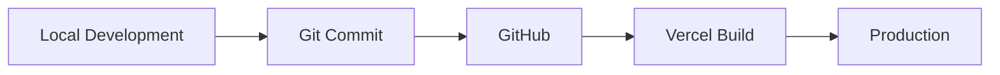

 <div align="center">

# ABDUL RAHUMAN

### Full Stack Developer | AI Enthusiast | Problem Solver

Building digital experiences. Exploring intelligent technologies. Turning ideas into practical solutions.

[**Live Portfolio ↗**](https://abdul-rahuman-portfolio-seven.vercel.app/) · [GitHub](https://github.com/Abdul-stack871) · [LinkedIn](https://www.linkedin.com/in/abdul-rahuman281/)


</div>

---

## 01. About the Portfolio

Welcome to my personal developer portfolio.

This website represents my journey as a developer, my interest in building meaningful software, and my exploration of Artificial Intelligence and modern web technologies.

It brings together my technical skills, selected projects, professional experience, academic background, certifications, and ways to connect with me — all in one place.

**The objective:** Present my work through a focused, interactive, and accessible digital experience.

## 02. Live Preview

<details>
<summary><strong>View portfolio website</strong></summary>

Visit the deployed website:

https://abdul-rahuman-portfolio-seven.vercel.app/

</details>

<!-- Add an actual website screenshot here:
     docs/images/portfolio-preview.png -->

## 03. Design & Experience

The portfolio follows a dark developer-focused visual direction.

| Design Element | Direction |
|---|---|
| Visual Theme | Minimal dark interface |
| Primary Accent | Warm Orange |
| Secondary Accent | Purple |
| Background | Matte Black / Charcoal |
| Typography | Clean, modern sans-serif |
| Experience | Responsive, interactive presentation |

The design prioritizes readable content, clear navigation, structured project presentation, and subtle motion.

## 04. Portfolio Sections

The website is organized into nine main sections.

| Section | What it presents |
|---|---|
| Hero | Introduction and professional positioning |
| Technology Stack | Development technologies and tools |
| Featured Projects | Selected software and AI projects |
| Experience & Journey | Internship and technical journey |
| Certifications & Achievements | Learning milestones and achievements |
| Education | Academic background |
| Currently Exploring | Current learning interests |
| Contact | Ways to reach me |
| Footer | Navigation and social profiles |

## 05. Technology Stack

My development toolkit includes:

**Programming Languages**


**Frontend Development**


**Backend & Database**


**Development Tools**


*These badges describe my broader development toolkit; they do not imply that every technology is used to build this portfolio website.*

## 06. Featured Projects

A selection of projects reflecting my interests in full-stack development and AI.

### 01 — Cognivis

**RAG-Based AI Knowledge Assistant**

An AI-powered knowledge assistant focused on retrieving relevant information from documents and generating context-aware responses.

Focus areas:
- Retrieval-Augmented Generation
- Document intelligence
- Context-aware AI responses

### 02 — StayMate AI

**Student Accommodation & Roommate Discovery Platform**

A platform designed to help students discover accommodation options and connect with potential roommates.

Technology:
- React
- Spring Boot
- MongoDB

[View GitHub Repository ↗](https://github.com/Abdul-stack871/Stay-Mate)

### 03 — NarratoVision

**Generative AI Storytelling & Image Generation**

An AI application combining text-based storytelling with AI-powered image generation.

Technology:
- Python
- Streamlit
- OpenRouter API
- Stable Diffusion

[View GitHub Repository ↗](https://github.com/Abdul-stack871/NarratoVission-AI)

## 07. Experience & Journey

**Web Development Intern — Aalan Tech Soft (ATS)**

June 09, 2025 – June 25, 2025

A 17-day internship providing practical exposure to web development and development-related tasks.

**Technical Activities**
- VIHANSA 2K26 — 24-hour National-Level Hackathon, NLP Sentiment Analysis problem.
- TECHNOVA '26 — National-Level Hackathon participation.
- ICRIT '26 — Research paper presentation on Integrated Cooperative Farming System with Farmer Connectivity and Crop Recommendation.
- Data Analytics using Statistical Tools — National-Level Workshop, Karpagam College of Engineering.

## 08. Certifications

- Human Computer Interaction — NPTEL, IIT Delhi, Elite, 86%.
- Design & Implementation of Human–Computer Interfaces — NPTEL, IIT Guwahati, Elite, 61%.
- Privacy and Security in Online Social Media — NPTEL, IIIT Hyderabad, 57%.
- Foundations of Cyber Security: Threats, Tools & Practical Defense — ISEA Project Phase III.

## 09. Education

**B.Tech — Artificial Intelligence and Data Science**

Dr. NGP Institute of Technology, Coimbatore

2023 – 2027 · Final Year

## 10. Currently Exploring

My current learning interests include:

- Full Stack Development
- Generative AI & Large Language Models
- Retrieval-Augmented Generation (RAG)
- AI Agents
- Modern Web Technologies
- Blockchain Technology

## 11. Getting Started

You can run the portfolio project locally.

### Prerequisites

- Node.js
- npm
- Git

### Clone the repository

```bash
git clone https://github.com/Abdul-stack871/abdul-rahuman-portfolio.git
```

### Navigate to the project

```bash
cd abdul-rahuman-portfolio
```

### Install dependencies

```bash
npm install
```

### Start development server

```bash
npm run dev
```

### Create production build

```bash
npm run build
```

The Vite production build is generated in the `dist` directory.

## 12. Deployment

This portfolio is deployed on Vercel.

**Live Website:**  
https://abdul-rahuman-portfolio-seven.vercel.app/

Deployment workflow:



## 13. Repository

**GitHub:**  
https://github.com/Abdul-stack871/abdul-rahuman-portfolio

## 14. Connect With Me

I'm always interested in connecting with developers, exploring new technologies, and discussing opportunities to build useful software.

<div align="center">

[](https://github.com/Abdul-stack871)

[](https://www.linkedin.com/in/abdul-rahuman281/)

[](https://leetcode.com/u/AbdulStack/)

[](mailto:abdulrahumanrock15@gmail.com)

</div>

---

<div align="center">

### Code. Create. Innovate. Repeat.

Designed and developed by **Abdul Rahuman**.

</div>
