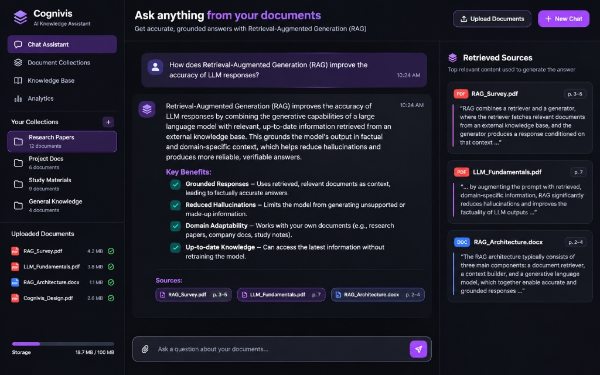
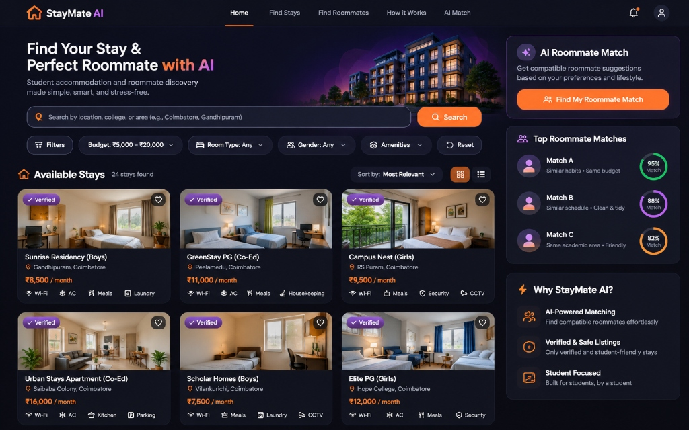
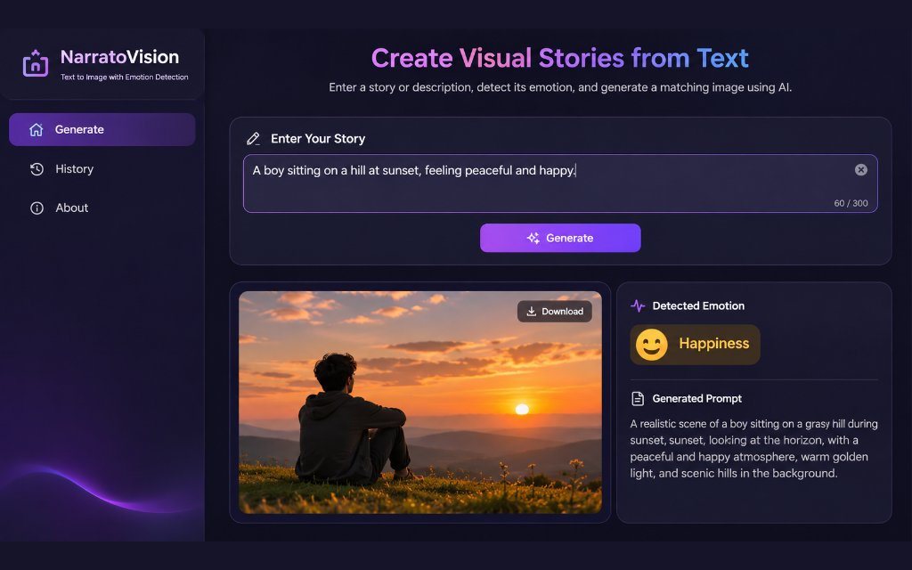
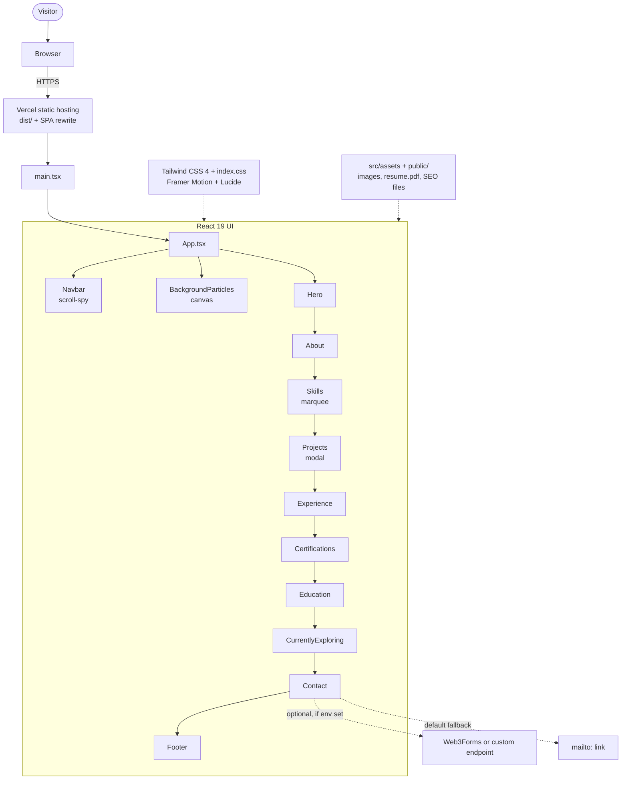

<div align="center">
 
# Abdul Rahuman | Developer Portfolio
 
**Full Stack Developer &nbsp;•&nbsp; AI Enthusiast &nbsp;•&nbsp; Problem Solver**
 
A single-page, dark-themed developer portfolio built with React 19, TypeScript, Vite and Tailwind CSS.
It presents projects, experience, certifications and contact options for recruiters and technical reviewers.
 
<br />
 
[](https://abdul-rahuman-portfolio-seven.vercel.app)
[](https://github.com/Abdul-stack871/abdul-rahuman-portfolio)
[](https://www.linkedin.com/in/abdul-rahuman281/)
[](mailto:abdulrahumanrock15@gmail.com)
 
</div>
 
---
 
## Table of Contents
 
[Overview](#overview) · [Preview](#portfolio-preview) · [Tech Stack](#technology-stack) · [Features](#key-features) · [Projects](#featured-projects) · [Experience](#experience-and-achievements) · [Certifications](#certifications) · [Architecture](#project-architecture) · [Structure](#project-structure) · [Getting Started](#getting-started) · [Build](#production-build) · [Deployment](#deployment) · [Security](#configuration-and-security) · [Roadmap](#future-improvements) · [Connect](#connect-with-me)
 
---
 
## Overview
 
This repository contains the source of my personal portfolio website. I built it to present my work in one place: AI and full stack projects, internship and hackathon experience, certifications, and a way to reach me.
 
It is aimed at recruiters, hiring managers and engineers who want a quick, honest view of what I have built and what I am learning.
 
What makes the implementation distinctive:
 
- **No router, no backend.** One React page with sectioned content and scroll-based navigation. The only network call is the optional contact form submission.
- **Data lives in components.** Projects, experience and certifications are typed arrays inside their components, so content updates need no CMS or API.
- **Custom visual identity.** Matte black base (`#0D0D0F`), warm orange (`#FF7547`) and subtle purple (`#9B72F2`) accents, set in Plus Jakarta Sans and Inter.
- **Honest contact form.** It never fakes success: if no email service is configured, it falls back to opening a prefilled `mailto:` message.
 
---
 
## Portfolio Preview
 
<div align="center">
 

 
<sub>Social preview card from <code>public/og-image.png</code> (used for Open Graph and Twitter cards). A full-page screenshot is not yet in the repository.</sub>
 
</div>
 
> **Screenshot placeholder:** a full-page capture of the deployed site is planned at `docs/images/portfolio-preview.png`. That file does not exist yet.
 
---
 
## Technology Stack
 
Everything below comes from `package.json` and the configuration files.
 
### Frontend
 


 
### Styling and UI
 


 
Also used: `clsx`, `tailwind-merge`, Google Fonts (Plus Jakarta Sans, Inter), and a custom `<canvas>` particle background.
 
### Development Tools
 


 
### Deployment
 

 
A `netlify.toml` with equivalent settings is also included.
 
### Backend and Database
 
None. This is a static front-end application. The contact form can optionally post to a third-party service ([Web3Forms](https://web3forms.com)) or a custom endpoint you provide.
 
> The **Tech Stack** section on the live site (Java, Spring Boot, Node.js, Express.js, MongoDB, etc.) lists skills I work with. They are showcased there as icons and are not dependencies of this repository.
 
---
 
## Key Features
 
| Feature | Details | Status |
| :-- | :-- | :--: |
| Sticky navigation | Scroll-spy highlighting, mobile drawer menu, "Let's Talk" call to action | Implemented |
| Scroll progress bar | Thin orange-to-purple bar at the top of the page | Implemented |
| Hero | Avatar, academic status badge, role line, resume download, social links | Implemented |
| About | Short bio with quick-facts grid (education, location, focus, interests) | Implemented |
| Animated tech stack | Two-row marquee of 14 technology icons with hover pause | Implemented |
| Featured projects | Three project cards, each with a detail modal (overview, problem, objective, features, architecture, contribution) | Implemented |
| Experience timeline | Internship, hackathons, research presentation and workshops | Implemented |
| Certifications and achievements | Four certification cards plus three achievement cards | Implemented |
| Education | Two institution cards with logos | Implemented |
| Currently exploring | Five focus-area cards | Implemented |
| Contact form | Client-side validation, HTML stripping, honeypot field, 20-second cooldown via `localStorage` | Implemented |
| Email delivery | Web3Forms or custom endpoint, only when the matching env variable is set | Configurable |
| Resume download | Serves `public/resume.pdf` as `Abdul_Rahuman_Resume.pdf` | Implemented |
| Footer | Social links, contact links, back-to-top button | Implemented |
| Responsive layout | Tailwind breakpoints across all sections | Implemented |
| Animations | Framer Motion reveal effects, hover transitions, canvas particle background | Implemented |
| SEO | Meta tags, Open Graph, Twitter card, JSON-LD `Person` schema, `robots.txt`, `sitemap.xml` | Implemented |
| Automated tests | No test script or test files in the repository | Not present |
 
---
 
## Featured Projects
 
<table>
  <tr>
    <td width="33%" valign="top">
      <br />
      <h3>Cognivis</h3>
      <sub><b>RAG / AI</b></sub>
      <p>RAG-based AI knowledge assistant. Upload documents, ask questions, and get answers with source citations (document, page and quoted passage).</p>
      <p><sub>Per the project card: Python, FastAPI, React, LLM, embeddings, vector database.</sub></p>
      <p><a href="https://github.com/Abdul-stack871/Cognivis">Source code</a></p>
    </td>
    <td width="33%" valign="top">
      <br />
      <h3>StayMate AI</h3>
      <sub><b>Full Stack</b></sub>
      <p>Student accommodation and roommate discovery platform with role-based authentication, map-based property search and roommate compatibility scoring.</p>
      <p><sub>Per the project card: React, Spring Boot, MySQL, JWT, Leaflet.</sub></p>
      <p><a href="https://github.com/Abdul-stack871/Stay-Mate">Source code</a></p>
    </td>
    <td width="33%" valign="top">
      <br />
      <h3>NarratoVision</h3>
      <sub><b>Generative AI</b></sub>
      <p>Generative AI storytelling and image generation application that pairs LLM-written narrative with scene-level visuals.</p>
      <p><sub>Per the project card: Python, Streamlit, OpenRouter API, Stable Diffusion.</sub></p>
      <p><a href="https://github.com/Abdul-stack871/NarratoVission-AI">Source code</a></p>
    </td>
  </tr>
</table>
 
No live demo links are published for these projects, so none are listed. Technology lists above are what each project card on the portfolio states; see each repository for the authoritative details.
 
---
 
## Experience and Achievements
 
| Entry | Organization | Details |
| :-- | :-- | :-- |
| Web Development Intern | Aalan Tech Soft (ATS) | 09 Jun 2025 – 25 Jun 2025 (17 days) |
| VIHANSA 2K26 | 24-hour national-level hackathon | Participated; NLP-based sentiment analysis problem |
| TECHNOVA '26 | National-level hackathon | Participant |
| ICRIT '26 | International Conference on Recent Innovations in Technology | Presented the paper "Integrated Cooperative Farming System with Farmer Connectivity and Crop Recommendation" |
| Cyber Security Workshop | ISEA Project Phase-III | 10-day workshop: Linux, VirtualBox, ethical hacking fundamentals |
| Data Analytics Using Statistical Tools | Karpagam College of Engineering, Coimbatore | National-level workshop, 17 Oct 2024 |
 
---
 
## Certifications
 
| Certification | Issuer | Shown on site |
| :-- | :-- | :-- |
| Human Computer Interaction | NPTEL, IIIT Delhi | NPTEL Elite, 86% |
| Design & Implementation of Human–Computer Interfaces | NPTEL, IIT Guwahati | NPTEL Elite, 61% |
| Privacy and Security in Online Social Media | NPTEL, IIIT Hyderabad | NPTEL, 57% |
| Foundations of Cyber Security: Threats, Tools & Defense | ISEA Project Phase III | Completed |
 
Certificate files are not hosted in this repository, so no certificate links are provided.
 
---
 
## Project Architecture
 
The application is a client-side single-page app. There is no router and no server component; navigation is scroll-based.
 

 
---
 
## Project Structure
 
```text
abdul-rahuman-portfolio/
├── public/
│   ├── 404.html            # Static 404 page
│   ├── _redirects          # Netlify SPA fallback
│   ├── favicon.svg
│   ├── icons.svg
│   ├── og-image.png        # Open Graph / Twitter preview (1200x630)
│   ├── resume.pdf          # Downloadable resume
│   ├── robots.txt
│   └── sitemap.xml
├── src/
│   ├── assets/             # Avatar, profile photo, project images, school logos
│   ├── components/
│   │   ├── Navbar.tsx
│   │   ├── Hero.tsx
│   │   ├── About.tsx
│   │   ├── Skills.tsx      # Animated technology marquee
│   │   ├── Projects.tsx    # Project cards + detail modal
│   │   ├── Experience.tsx  # Timeline
│   │   ├── Certifications.tsx
│   │   ├── Education.tsx
│   │   ├── CurrentlyExploring.tsx
│   │   ├── Contact.tsx     # Form, validation, delivery logic
│   │   ├── Footer.tsx
│   │   └── BackgroundParticles.tsx
│   ├── App.tsx             # Page composition and scroll progress bar
│   ├── main.tsx            # React entry point
│   └── index.css           # Tailwind import, theme tokens, card styles
├── .env.example            # Optional contact-form variables (no secrets)
├── .gitignore
├── index.html              # SEO metadata, JSON-LD, font links
├── netlify.toml            # Alternative host configuration
├── package.json
├── tsconfig.json           # References tsconfig.app.json and tsconfig.node.json
├── vercel.json             # Build, rewrites, cache and security headers
└── vite.config.ts          # React and Tailwind Vite plugins
```
 
---
 
## Getting Started
 
### Prerequisites
 
- **Node.js** `^20.19.0` or `>=22.12.0` (the range required by Vite 8; `package.json` does not declare an `engines` field)
- **npm** (a `package-lock.json` is included)
 
### Install and run
 
The same commands work on Windows (PowerShell or Command Prompt), macOS and Linux.
 
```bash
git clone https://github.com/Abdul-stack871/abdul-rahuman-portfolio.git
cd abdul-rahuman-portfolio
npm install
npm run dev
```
 
Vite prints the local URL when it starts (by default `http://localhost:5173`).
 
### Available scripts
 
| Command | What it does |
| :-- | :-- |
| `npm run dev` | Start the Vite dev server |
| `npm run build` | Type-check with `tsc -b`, then build with Vite |
| `npm run preview` | Serve the production build locally |
| `npm run lint` | Lint with Oxlint |
 
---
 
## Production Build
 
```bash
npm run build
```
 
The build runs `tsc -b` first, so type errors fail the build. Vite then writes the optimized site to **`dist/`**. This is Vite's default output directory, and `vercel.json` and `netlify.toml` both point at it. Preview it locally with `npm run preview`.
 
---
 
## Deployment
 
The site is deployed on **Vercel**. `vercel.json` configures:
 
- `framework: vite`, `buildCommand: npm run build`, `outputDirectory: dist`
- A catch-all rewrite to `/index.html` for SPA fallback
- Long-lived immutable caching for `/assets/*`
- Security headers: `X-Content-Type-Options`, `X-Frame-Options: DENY`, `X-XSS-Protection`, `Referrer-Policy`
 
To deploy your own copy:
 
1. Push your changes to GitHub.
2. Import the repository in Vercel.
3. Keep the **Vite** framework preset. The build command and output directory are read from `vercel.json`.
4. *(Optional)* Add contact-form environment variables (see below).
5. Deploy.
 
Whether pushes to GitHub trigger automatic deployments depends on the Vercel project's Git integration, which is configured in Vercel and cannot be verified from this repository.
 
---
 
## Configuration and Security
 
**Environment variables** are optional and only used by the contact form (`.env.example`):
 
| Variable | Purpose |
| :-- | :-- |
| `VITE_WEB3FORMS_ACCESS_KEY` | Sends messages through Web3Forms |
| `VITE_CONTACT_ENDPOINT` | Sends messages to your own POST endpoint |
 
If neither is set, the form opens a prefilled `mailto:` message instead.
 
**Things to know:**
 
- Variables prefixed with `VITE_` are bundled into the public JavaScript. Treat them as public values, never as private secrets. Put real secrets behind a server-side function.
- `.gitignore` excludes `.env`, `.env.local`, `.env.*.local`, `node_modules`, `dist` and `.vercel`, while keeping `.env.example` tracked.
- Contact-form protections are client-side: input sanitization, a honeypot field and a 20-second `localStorage` cooldown. They reduce casual spam but are not a substitute for server-side validation.
- No secrets are stored in this repository.
 
---
 
## Future Improvements
 
None of these are implemented yet.
 
- [ ] Add a full-page screenshot at `docs/images/portfolio-preview.png`
- [ ] Add automated tests and a CI workflow (lint, type-check, build)
- [ ] Add a `Content-Security-Policy` header in `vercel.json`
- [ ] Publish live demo links for projects once they are deployed
- [ ] Add a case-study entry for TraceIQ, an AI-powered production incident intelligence platform that is currently at the planning and concept stage
 
---
 
## Connect With Me
 
<div align="center">
 
[](https://github.com/Abdul-stack871)
[](https://www.linkedin.com/in/abdul-rahuman281/)
[](https://leetcode.com/u/AbdulStack/)
[](mailto:abdulrahumanrock15@gmail.com)
 
</div>
 
---
 
<div align="center">
 
**Designed and developed by Abdul Rahuman.**
 
<sub>Code. Create. Innovate. Repeat.</sub>
 
</div>
 
